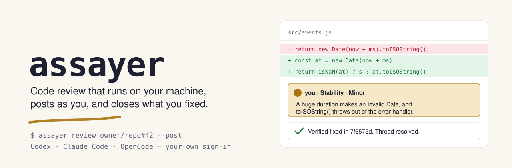
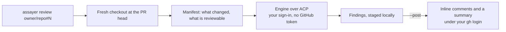

<picture>
  <source media="(prefers-color-scheme: dark)" srcset="docs/assets/hero-dark.svg">
  
</picture>

[](LICENSE)


> [!WARNING]
> Assayer is **alpha**. Any 0.0.x release may change behaviour or break a
> workflow; read the [release notes](https://github.com/prismalens/assayer/releases)
> before you upgrade. See [VERSIONING.md](VERSIONING.md).

Assayer is open source code review that runs on your machine with your own Codex, Claude Code or OpenCode sign-in. It reviews a pull request, posts its findings inline under your own GitHub login, and can review what you are about to push before you push it. There is no hosted service and no extra API key.

- **Your machine, your sign-in.** The engine runs locally with the account or key you already use. Assayer stores no model key, passes the engine no GitHub credential, and only Assayer posts. The engine still runs as you: [what each engine can read](docs/how-it-works.md#what-the-engine-can-read).
- **Before you push, too.** `assayer review` with no pull request reviews your uncommitted work in a snapshot, and an opt-in pre-push hook warns when what you push has no review or had a major finding.
- **Engines are interchangeable.** Codex, Claude Code and OpenCode run over the [Agent Client Protocol](https://agentclientprotocol.com), so you switch with `--engine`.

## Quick start

You need Linux or macOS (on Windows, use WSL), Node 22 or newer, `git`, `python3` and the [GitHub CLI](https://cli.github.com) signed in (`gh auth login`).

```bash
npm i -g @prismalens/assayer
assayer review owner/repo#123              # review a pull request and print the findings
```

The first review asks which engine to use (Codex, Claude Code or OpenCode) and saves your answer. If that engine is not installed, Assayer shows the `npm i -g` command for it and offers to run it; you then sign in to the engine once, the way you normally would. `assayer doctor` shows what this machine has.

```bash
assayer review owner/repo#123 --post       # post the findings on the pull request, as you
assayer review                             # review your local changes before you push
assayer config set engine claude-code      # the engine every review uses from now on
```

To try it without installing anything, one command does the same round: `npx @prismalens/assayer review owner/repo#123`. The pre-push hook needs the global install.

From a checkout instead of npm: `cd runner && npm ci && npm link`.

## What a round looks like

Assayer reviewing [a demo pull request](https://github.com/Sumit1993/todo-app-api/pull/13) with Codex. The pull request has bugs put there on purpose; the output is the round's own, unedited:

```text
assayer: Sumit1993/todo-app-api#13 at 1a881a5 with codex
completed: 5 finding(s) in 382s
  [Critical] src/todos/todos.service.ts:241  Await every bulk update before returning success
  [Major] src/todos/todos.service.ts:210  Include the user ID in the page cache key
  [Major] src/todos/todos.service.ts:217  Use a zero-based offset for the first page
  [Major] src/todos/todos.controller.ts:40  Validate the bulk IDs before dereferencing them
  [Major] src/todos/todos.controller.ts:36  Reject invalid pagination before calling the upstream API
```

With `--post`, each finding lands as an inline comment ending in a hidden `assayer-finding` marker, and a summary comment gives the coverage. `assayer publish <round dir>` posts or resumes a round that already ran.

## Before you push

`assayer review` with no pull request reviews what you have not pushed yet: unpushed commits plus staged, unstaged and untracked files. It compares against your branch's upstream, or `origin`'s default branch, or `main`; `--base <ref>` picks another. Your working tree, index and stash are never touched: the round reviews a snapshot in its own checkout. It only prints, and `--fail-on major` makes it exit 4 when it finds anything major or worse.

`assayer hook install` adds an opt-in pre-push hook. It never starts a review, because a review takes minutes. It checks whether the commit you are pushing was reviewed and what was found, counting every review of that exact code, so a later clean run does not hide an earlier finding. It warns by default, and blocks only with `git config assayer.prepush block`. `git push --no-verify` always skips it.

## How it works



It refuses before spending any quota when the pull request is closed, carries the `claude_review_skip` label, or already has a review from this engine on its head. `runner/README.md` lists every flag and refusal.

## Engines

| Engine | Install | Sign-in |
| --- | --- | --- |
| Codex | `npm i -g @openai/codex @agentclientprotocol/codex-acp@2.1.1` | `codex login`, or `OPENAI_API_KEY` |
| Claude Code | `npm i -g @anthropic-ai/claude-code @agentclientprotocol/claude-agent-acp@0.89.1 --allow-scripts=@anthropic-ai/claude-code` | run `claude` and type `/login`, or `ANTHROPIC_API_KEY` |
| OpenCode | `npm i -g opencode-ai@1.18.30 --allow-scripts=opencode-ai` | none needed for its free models, though they often stall mid-round; pick one with `--model` |

Use whichever sign-in your plan offers. Each provider's own terms apply: [OpenAI](https://openai.com/policies/), [Anthropic](https://www.anthropic.com/legal), [OpenCode](https://opencode.ai). `assayer doctor` shows which engines are ready on this machine.

A round runs the engine with your own harness setup: its settings, skills, plugins and MCP servers load as they do when you run it yourself, and the model is the one you configured unless `--model` names another. Assayer adds only its boundaries: no GitHub credential, read-only review, and a pull request's own agent config put back to the base branch's version ([how it works](https://github.com/prismalens/assayer/blob/main/docs/how-it-works.md)).

## Use it from Claude Code or Codex

The `assayer-review` skill teaches an agent to run a round, show you the findings before posting, and work the threads.

- Claude Code: `/plugin marketplace add prismalens/assayer`, then `/plugin install assayer@assayer`.
- Codex: copy `plugin/skills/assayer-review` into `~/.codex/skills/`.

## Telemetry

The first `assayer` run in a terminal prints a notice and sends nothing. Later runs send usage counts to PostHog's EU region, so we can see whether Assayer is used and where rounds fail.

| Event | Properties |
| --- | --- |
| `install_active` | at most once a UTC day |
| `round_finished` | `pr` or `local`, engine, conclusion, findings bucket (`0`, `1`, `2-5`, `6-20`, `>20`), duration bucket, whether it was posted |
| `refused` | `pr` or `local`, engine, and which refusal: `closed`, `skip_label`, `already_reviewed`, `repo_config`, `no_base`, `no_changes`, `no_repo` |

Every event also carries `product`, how it was installed (`npm` or `checkout`), OS, CPU architecture, Node major version, the Assayer version, and a random install id kept in `~/.assayer/telemetry.json`. Timestamps are cut to the UTC day, and IP geolocation is turned off. Assayer never sends repository names, paths, logins, code, prompts, findings or model output.

`assayer telemetry off` turns it off, `assayer telemetry on` back on, and `assayer telemetry status` shows the last 20 events sent. `ASSAYER_TELEMETRY=off`, `DO_NOT_TRACK=1` and `CI` each turn it off whatever the stored answer, and a run with no terminal never shows the notice, so it never starts.

## Known limits

- Assayer does not yet re-check its own threads on a later round. Reply in a thread with the fixing commit and resolve it yourself.
- A repository with `.github/claude-review.yml` is refused until the config resolver ships; `--ignore-repo-config` reviews it with the defaults.

## Layout

| Path | What it is |
| --- | --- |
| `runner/` | The `assayer` CLI and the engine runner over the Agent Client Protocol |
| `plugin/` | The Claude Code and Codex plugin |
| `docs/` | The documentation site |

## License

Apache-2.0. See `LICENSE`.

Contributing: see CONTRIBUTING.md. Security reports: see SECURITY.md.
