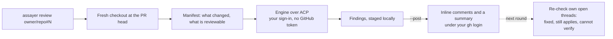

<picture>
  <source media="(prefers-color-scheme: dark)" srcset="docs/assets/hero-dark.svg">
  
</picture>

[](LICENSE)


Assayer is open source code review that runs on your machine with your own Codex, Claude Code or OpenCode sign-in. It reviews a pull request, posts its findings inline under your own GitHub login, and on the next round re-checks its own threads and resolves the ones you fixed. There is no hosted service and no extra API key.

- **Your machine, your sign-in.** The engine runs locally with the account or key you already use. Assayer stores no model key, and the engine never gets a GitHub credential.
- **It finishes the conversation.** A finding stays open until a later round verifies the fix, then gets a one-line reply naming the commit and is resolved. A thread someone answered is re-judged rather than reposted.
- **Engines are interchangeable.** Codex, Claude Code and OpenCode run over the [Agent Client Protocol](https://agentclientprotocol.com), so you switch with `--engine`.

## Quick start

You need Node 24 or newer, `git`, `python3`, the GitHub CLI and one engine.

```bash
git clone https://github.com/prismalens/assayer && cd assayer
cd runner && npm ci && npm link            # npm i -g @prismalens/assayer after the first release
npm i -g @openai/codex@0.162.1 @agentclientprotocol/codex-acp@2.1.1 && codex login   # the default engine
gh auth login

assayer doctor                             # what this machine has for a round
assayer review owner/repo#123              # review and print
assayer review owner/repo#123 --post       # post the findings as you
```

## What a round looks like

This is Assayer reviewing its own first pull request with Codex. It printed the round and posted nothing:

```text
assayer: prismalens/assayer#1 at ec52d77 with codex
assayer-run: completed in 385s, 64 tool calls, 19 reads, 3 findings, summary=true
completed: 3 finding(s) in 385s
  plugin/skills/assayer-review/SKILL.md:47  Do not tell agents to wait for automatic thread resolution
  README.md:12  Install the Codex CLI before invoking codex login
  README.md:3  Remove the unsupported automatic follow-up promise

## Code review
🟠 Major — 3 inline findings ...
Coverage: examined 8 of 8 reviewable files.
```

With `--post`, each finding lands as an inline comment ending in a hidden `assayer-finding` marker, and a summary comment gives the coverage. `assayer publish <round dir>` posts or resumes a round that already ran.

## How it works



Before a new review, Assayer re-checks the open threads it started. Those whose file changed, or that someone answered, go back to the engine, which judges each one fixed, still applies or cannot verify. Fixed threads get a reply naming the commit and are resolved. The others stay open and are passed to the review as already raised, so a finding is never posted twice.

It refuses before spending any quota when the pull request is closed, carries the `claude_review_skip` label, or already has a review from this engine on its head. `runner/README.md` lists every flag and refusal.

## Engines

| Engine | Install | Sign-in |
| --- | --- | --- |
| Codex (default) | `npm i -g @openai/codex @agentclientprotocol/codex-acp` | `codex login`, or `OPENAI_API_KEY` |
| Claude Code | `npm i -g @anthropic-ai/claude-code @agentclientprotocol/claude-agent-acp` | `claude` sign-in, or `ANTHROPIC_API_KEY` |
| OpenCode | `npm i -g opencode-ai` | none needed for its free models |

Use whichever sign-in your plan offers. Each provider's own terms apply: [OpenAI](https://openai.com/policies/), [Anthropic](https://www.anthropic.com/legal), [OpenCode](https://opencode.ai). `assayer doctor` shows which engines are ready on this machine.

## Use it from Claude Code or Codex

The `assayer-review` skill teaches an agent to run a round, show you the findings before posting, and work the threads.

- Claude Code: `/plugin marketplace add prismalens/assayer`, then `/plugin install assayer@assayer`.
- Codex: copy `plugin/skills/assayer-review` into `~/.codex/skills/`.

## Telemetry

The first `assayer` run in a terminal prints a notice and sends nothing. Later runs send usage counts to PostHog's EU region, so we can see whether Assayer is used and where rounds fail.

| Event | Properties |
| --- | --- |
| `install_active` | at most once a UTC day |
| `round_finished` | engine, conclusion, findings bucket (`0`, `1`, `2-5`, `6-20`, `>20`), duration bucket, whether it was posted |
| `refused` | engine, and which refusal: `closed`, `skip_label`, `already_reviewed`, `repo_config` |

Every event also carries `product`, how it was installed (`npm` or `checkout`), OS, CPU architecture, Node major version, the Assayer version, and a random install id kept in `~/.assayer/telemetry.json`. Timestamps are cut to the UTC day, and IP geolocation is turned off. Assayer never sends repository names, paths, logins, code, prompts, findings or model output.

`assayer telemetry off` turns it off, and `assayer telemetry status` shows the last 20 events sent. `ASSAYER_TELEMETRY=off`, `DO_NOT_TRACK=1` and `CI` each turn it off whatever the stored answer, and a run with no terminal never shows the notice, so it never starts.

## Known limits

- It reviews pull requests. Reviewing local changes before you push is planned.
- A repository with `.github/claude-review.yml` is refused until the config resolver ships; `--ignore-repo-config` reviews it with the defaults.
- GitHub has no conditional comment write or resolve, so a reply that lands in the moment between Assayer's last check and its resolve is not seen. It stays visible on the resolved thread.

## Layout

| Path | What it is |
| --- | --- |
| `runner/` | The `assayer` CLI and the engine runner over the Agent Client Protocol |
| `plugin/` | The Claude Code and Codex plugin |
| `docs/` | The documentation site |

## License

Apache-2.0. See `LICENSE`.

Contributing: see CONTRIBUTING.md. Security reports: see SECURITY.md.
